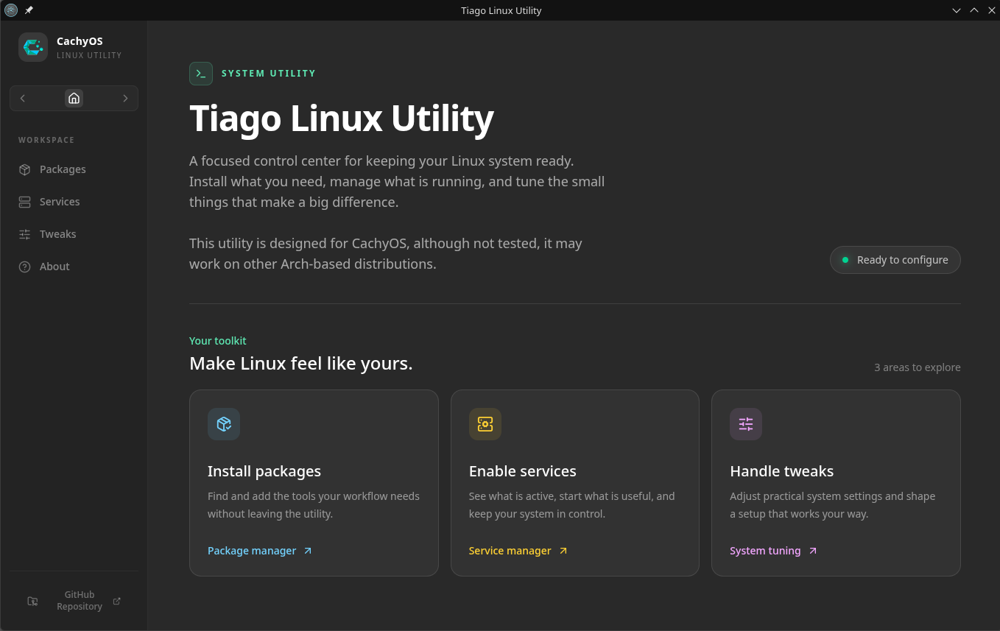

# Tiago Linux Utility

A focused desktop control center for configuring a CachyOS Linux system.
It helps you install packages, enable services, and apply
useful system tweaks without leaving one place.



## Features

- Install packages with `yay`
- Enable and start systemd services
- Apply curated system tweaks
- Use polkit for administrator authorization
- See progress and errors while commands run

The application is designed for CachyOS and may work on other Arch-based
distributions.

## Requirements

- Linux with an active polkit authentication agent
- Node.js 24 or newer
- npm 10 or newer
- `yay` installed and available in `PATH`
- The Chaotic-AUR repository enabled

```ini
[chaotic-aur]
Include = /etc/pacman.d/chaotic-mirrorlist
```

## Development

Clone the repository and install dependencies:

```bash
git clone https://github.com/TiagoRibeiro25/tiago-linux-utility.git
cd tiago-linux-utility
npm install
```

Start the application in development mode:

```bash
npm start
```

Create a Linux AppImage:

```bash
npm run package
```

## License

MIT © [Tiago Ribeiro](https://github.com/TiagoRibeiro25)
